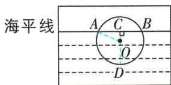
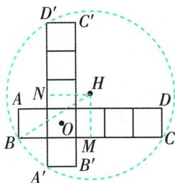

> [!success]- 必刷题
>
> > [!success] **【答案】** D
>
> > [!note]- **【解析】**
> > 如图, 过 $\odot O$ 的圆心 $O$ 作 $CD \perp AB$ 于 $C$ , 交 $\odot O$ 于 $D$ , 连接 $OA, \therefore AC = \frac{1}{2} AB = \frac{1}{2} \times 16 = 8$ (厘米). 在 Rt $\triangle AOC$ 中, $OC = \sqrt{OA^2 - AC^2} = \sqrt{10^2 - 8^2} = 6$ (厘米), $\therefore CD = OC + OD = 16$ (厘米). $\because$ 太阳从目前所处位置到太阳完全离开海平线的时间为 16 分钟, $\therefore 16 \div 16 = 1$ (厘米/分), $\therefore$ 图中太阳升起的速度为 1 厘米/分. 故选 D.
> >
> > 
> >
> > 
> > (第1题图)
> > (第2题图)
