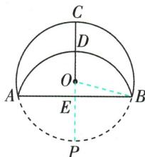

> [!success]- 必刷题
>
> > [!success] **【答案】** B
>
> > [!note]- **【解析】**
> > 如图,延长 CO 交 AB 于 E,交 ⊙O ▶ 思路分析
> > 于 P. ∵ CE⊥AB, ∴ AE = BE = $\frac{1}{2}$ AB. 连接 OB. 延长 CO 交 AB 于 E, 交
> >
> > ∵ $\widehat{AB}$ 恰好经过与 AB 垂直的半径 OC 的中点 D, $\odot O$ 的半径为 8, ∴ OD = CD = $\frac{1}{2}OC = 4$ . ∵ 将半径为 8 的
> >
> > 
> >
> > $\odot O$ 沿 $AB$ 折叠， $\therefore DE = PE = \frac{1}{2} (PC - CD) =$ $\frac{1}{2}\times (8\times 2 - 4) = 6,\therefore OE = DE - OD = 6 - 4 = 2,$ $\therefore BE = \sqrt{OB^2 - OE^2} = \sqrt{8^2 - 2^2} = 2\sqrt{15},\therefore AB =$ $2BE = 4\sqrt{15}.$ 故选B.
> >
> > 延长 $CO$ 交 $AB$ 于 $E$ , 交 $\odot O$ 于 $P$ . 由 $CO$ 与 $AB$ 垂直及垂径定理得到 $E$ 为 $AB$ 的中点, 连接 $OB$ , 构造直角三角形 $OBE$ . 根据折叠的性质得出 $DE = PE = \frac{1}{2} (PC - CD)$ , 即可求出 $OE$ 的长, 根据勾股定理求出 $BE$ 的长, 进而得出 $AB$ 的长.
