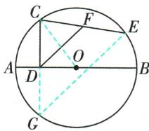

> [!success]- 必刷题
>
> > [!success] **【答案】** 7
>
> > [!note]- **【解析】**
> > 如图,延长 CD 接 GE, OC. ∵ CD ⊥ AB, 即 CG ⊥ AB, 且 AB 是 ⊙ O 的直径, ∴ CD = DG. 又∵ 点 F 为 CE 的中点, ∴ DF = $\frac{1}{2}$ GE. 当 GE 为直径时, GE
> >
> > 
> >
> > 取得最大值, 此时 DF 取得最大值. 设 $\odot O$ 的半径为 r, 则 OD = r - 3. 在 Rt $\triangle OCD$ 中, $OC^{2} = OD^{2} + CD^{2}$ , $\therefore r^{2} = (r - 3)^{2} + 6^{2}$ , 解得 r = 7.5, $\therefore GE$ 的最大值为 15, $\therefore DF$ 的最大值为 7.5, 故答案为 7.5.
