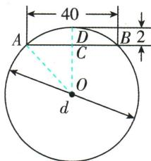

> [!success]- 必刷题
>
> > [!success] **【答案】** D
>
> > [!note]- **【解析】**
> > 【解】(1)如图,设圆心为O,过点O作OC⊥AB于点C,OC的延长线交⊙O于点D,连接OA.
> >
> > $\because OC \perp AB, AB = 40,$ $\therefore AC = BC = 20.$ 设 $OA = r\mathrm{mm}$ $\because CD = 2, \therefore OC = r - 2.$ 在 Rt△AOC 中，根据勾股定理得 $AC^2 + OC^2 = OA^2$
> >
> > 
> >
> > 切入点.（构造模型）
> >
> > 关键点.（数学建模）
> >
> > 即 $20^{2}+(r-2)^{2}=r^{2}$ ，解得 r=101，
> > ∴ $d=2\times101=202$ ，即 d 的值为 202.
> > (2) 当 CD=4 时, OC=r-4=97.
> > ∵ OC⊥AB, ∴ AC=BC. 在 Rt△AOC 中, 根据勾股定理得 $AC^{2}+OC^{2}=OA^{2}$ , 即 $AC^{2}+97^{2}=101^{2}$ ,
> > 解得 $AC = 6\sqrt{22}, \therefore AB = 12\sqrt{22}, \therefore$ 轴上铣出平面的宽度为 $12\sqrt{22}$ mm.
> >
> > 卡壳点.（吃刀深度）
> >
> > ## 刷素养·
