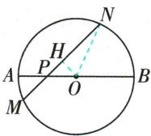

> [!success]- 必刷题
>
> > [!success] **【答案】** 详见解析
>
> > [!note]- **【解析】**
> > 【解】(1)如图,作 $OH \perp MN$ 于 H, 连接 ON.
> > ∵ AP = 2, BP = 6, ∴ AB = 8, ∴ OA = 4, OP = 2. 在
> >
> > 
> >
> > Rt△POH 中，∵∠OPH = 45°, ∴ 易得 $OH = \frac{\sqrt{2}}{2} OP = \sqrt{2}$ . 在 Rt△OHN 中，∵ ON = 4, $OH = \sqrt{2}$ , ∴ $NH = \sqrt{NO^{2} - OH^{2}} = \sqrt{4^{2} - (\sqrt{2})^{2}} = \sqrt{14}$ . ∵ $OH \perp MN$ , ∴ HM = HN, ∴ MN = 2NH = 2√14.
> >
> > (2) 作 $OH \perp MN$ 于 H，连接 ON，则 HM = HN.
> >
> > ∵ MP = 3, NP = 5, ∴ MN = 8, ∴ HM = HN = 4, ∴ PH = 1. 在 Rt△POH 中，∵ ∠OPH = 45°, ∴ OH = PH = 1. 在 Rt△OHN 中，∵ HN = 4, OH = 1, ∴ $ON = \sqrt{OH^{2} + NH^{2}} = \sqrt{17}$ , ∴ AB = 2ON = 2√17.
> >
> > (3) $\frac{PM^{2} + PN^{2}}{AB^{2}}$ 的值不发生变化，为定值 $\frac{1}{2}$ .
> >
> > 作 $OH \perp MN$ 于 H，连接 ON，则 HM = HN. 设圆的半径为 R. 在 Rt△OHN 中， $OH^{2} + NH^{2} = ON^{2} = R^{2}$ ，在 Rt△POH 中，∵ ∠OPH = 45°, ∴ OH = PH, ∴ $PH^{2} + NH^{2} = R^{2}$ . ∵ $PM^{2} + PN^{2} = (HM - PH)^{2} + (NH + PH)^{2} = (NH - PH)^{2} + (NH + PH)^{2} = 2(PH^{2} + NH^{2}) = 2R^{2}$ . 又∵ $AB^{2} = 4R^{2}$ ,
> >
> > ∴ $\frac{PM^{2} + PN^{2}}{AB^{2}} = \frac{2R^{2}}{4R^{2}} = \frac{1}{2}$ , ∴ $\frac{PM^{2} + PN^{2}}{AB^{2}}$ 的值不发生变化，为定值 $\frac{1}{2}$ .
> >
> > ## 24.1.3 弧、弦、圆心角
