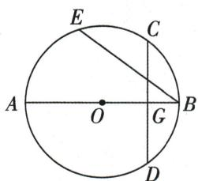
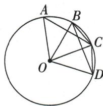

<!-- question-source:start -->
5[2025 浙江温州期中]如图,AB为 $\odot O$ 的直径,点C是弧BE的中点.过点C作CD⊥AB于点G,交 $\odot O$ 于点D,若BE=8,BG=3,则 $\odot O$ 的半径长是() A.4 B.5.5 C. $\frac{25}{6}$ D. $\frac{25}{3}$

(第 5 题图)

(第6题图)
<!-- question-source:end -->

![[Q00106854A1]]
