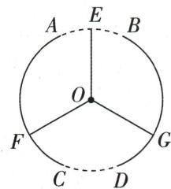
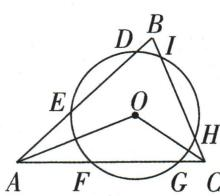

<!-- question-source:start -->
7 某酒店的圆形旋转门, 可看成如图所示由外围的 $\odot O$ 和 3 翼隔风玻璃组成, 外围圆有通道弧 AB 和弧 CD, 且它们关于圆心 O 中心对称, 圆内的 3 翼隔风玻璃可绕圆心 O 转动, 且所成的夹角 $\angle EOF = \angle FOG = \angle GOE = 120^{\circ}$ , 3 翼隔风玻璃在转动过程中, 始终使大厅内外空气隔离, 起到对大厅内保温的作用. 例如: 当隔风玻璃转到如图位置时, 大厅内外空气被隔风玻璃 OF, OG 隔离. 则通道弧 AB 所对圆心角的度数的最大值为 ( )
A. $30^{\circ}$ B. $60^{\circ}$ C. $90^{\circ}$ D. $120^{\circ}$

(第7题图)

(第8题图)
<!-- question-source:end -->

![[Q00106856A1]]
