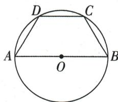

<!-- question-source:start -->
9 如图, 已知 $\odot O$ 的半径等于 2 cm, AB 是直径, C, D 是 $\odot O$ 上的两点, 且 $\widehat{AD} = \widehat{DC} = \widehat{CB}$ , 求四边形 ABCD 的周长.

<!-- question-source:end -->

![[Q00106858A1]]
