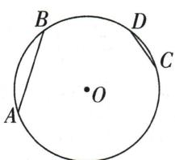
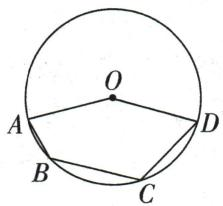

<!-- question-source:start -->
1[2025 河北石家庄期中, 中]如图, A, B, C, D 是
⊙O 上的点, 且 $\widehat{AB}=2\widehat{CD}$ , 若 AB=6, 则 CD 的长可能是
() A. 1 B. 2 C. 3 D. 4

(第1题图)

(第2题图)
<!-- question-source:end -->

![[Q00106859A1]]
