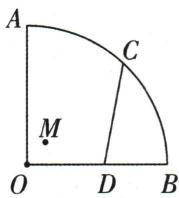
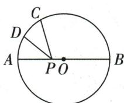

<!-- question-source:start -->
3[2024 湖北武汉期中,较难]如图,已知在扇形OAB中, $\angle AOB=90^{\circ},OB=4,C$ 为弧AB的中点,D为半径OB上一动点,点B关于直线CD的对称点为M,若点M落在扇形OAB内(不含边界),则OD长的取值范围是()A. $4\sqrt{2}-4<OD<2\sqrt{2}$ B. $2\sqrt{2}<OD<4\sqrt{2}$ C. $0<OD<2\sqrt{2}$ D. $4-2\sqrt{2}<OD<4$

(第3题图)

(第4题图)
<!-- question-source:end -->

![[Q00106861A1]]
