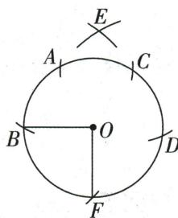

<!-- question-source:start -->
5[2025 江苏宿迁质检, 中]已知 $\odot O$ 的半径为 $1\mathrm{cm}$ , 小明同学进行如下操作 (如图): I. 在 $\odot O$ 上任取一点 $A$ , 以 $A$ 为圆心, $1\mathrm{cm}$ 为半径作弧, 与 $\odot O$ 相交于 $B, C$ 两点; II. 以 $C$ 为圆心, $1\mathrm{cm}$ 为半径作弧与 $\odot O$ 相交于点 $D$ ;

Ⅲ. 分别以 B, D 为圆心, B, C 两点间的距离为半径作弧在 $\odot O$ 上方相交于点 E;
Ⅳ. 以 B 为圆心, O, E 两点间的距离为半径作弧与 $\odot O$ 相交于点 F.
(1)B,D 两点之间的距离为\_\_\_\_;B,C 两点之间的距离为\_\_\_\_;
(2)连接 OB,OF,试猜想∠BOF 的度数,并证明你的猜想.

<!-- question-source:end -->

![[Q00106863A1]]
