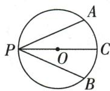
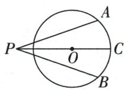
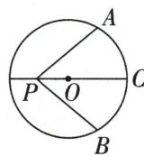

<!-- question-source:start -->
6 核心素养推理能力 [较难] 如图(1), PC 是 $\odot O$ 的直径, PA 与 PB 是弦, 且 $\angle APC = \angle BPC$ .

(1) 求证: $PA = PB$ .

(2) 若点 P 由圆上运动到圆外, PC 过圆心, 如图(2), 是否仍有 PA = PB? 为什么?

(3)如图(3),若点P由圆上运动到圆内,PC过圆心,(1)中结论是否仍然成立?请说明理由.

图(1)

图(2)

图(3)

电子错题本鸭
<!-- question-source:end -->

![[Q00107264A1]]
