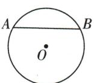
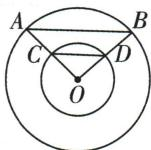
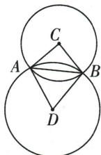

> [!success]- 必刷题
>
> > [!success] **【答案】** B
>
> > [!note]- **【解析】**
> > A 选项, 如图(1), 弦 AB = 弦 AB, 但是所对的两段弧不相等, 故本选项不符合题意; B 选项, 在同圆或等圆中, 相等的弧所对的弦相等, 故本选项符合题意; C 选项, 如图(2), $\angle AOB = \angle COD$ , 但是弦 AB 和弦 CD 不相等, 故本选项不符合题意; D 选项, 如图(3), 弦 AB = 弦 AB, 但是圆心角 $\angle ADB$ 和$\angle ACB$ 不相等,故本选项不符合题意. 故选 B.
> >
> > 
> >
> > 
> > 图(1)
> >
> > 
> > 图(2)
> > 图(3)
