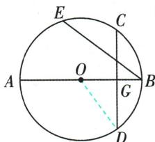

> [!success]- 必刷题
>
> > [!success] **【答案】** C
>
> > [!note]- **【解析】**
> > 连接 OD, 如图. 设 $\odot O$ 的半径长为 r.
> > ∵ CD ⊥ AB, AB 为 $\odot O$ 的直径, ∴ $\widehat{BC} = \widehat{BD}$ , CG = DG. ∵ 点 C 是 $\widehat{BE}$ 的中
> >
> > 
> >
> > 思路分析
> > 先根据弧、弦之间的关系得到相关线段长,再利用勾股定理进行求解即可.
> >
> > 点，∴ $\widehat{CE} = \widehat{CB}, \therefore \widehat{BE} = \widehat{CD}, \therefore CD = BE = 8,$ ∴ $DG = \frac{1}{2} CD = 4.$ ∵ BG = 3, ∴ OG = r - 3. 在 Rt△OGD 中， $DG^{2} + OG^{2} = OD^{2}, \therefore 4^{2} + (r - 3)^{2} = r^{2}$ ，解得 $r = \frac{25}{6}, \therefore \odot O$ 的半径长为 $\frac{25}{6}$ .
> >
> > 故选 **C**.
