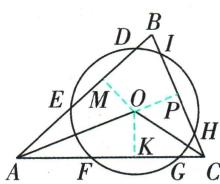
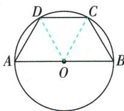

> [!success]- 必刷题
>
> > [!success] **【答案】** B
>
> > [!note]- **【解析】**
> > ∵ $\angle EOF = \angle FOG = \angle GOE = 120^{\circ}$ ,
> > ∴ $\angle AOC$ 与 $\angle BOD$ 的最小值为 $120^{\circ}$ ,
> > ∴ $\angle AOB$ 与 $\angle COD$ 最大值的和为 $120^{\circ}$ .
> > ∵ 弧 AB 和弧 CD 关于圆心 O 中心对称，
> > ∴ $\widehat{AB} = \widehat{CD}$ , ∴ $\angle AOB = \angle COD$ , ∴ 弧 AB 所对圆心角度数的最大值为 $60^{\circ}$ ，故选 B.
> >
> > ## 关键点拨
> >
> > 添加辅助线
> > 由弦 DE=FG=HI, 联想到弦和弦心距之间的关系, 过点 O 作 OM⊥DE 于 M, OK⊥FG 于 K, OP⊥HI 于 P, 得到 OM=OP=OK, 即点 O 是 △ABC 的角平分线的交点.
> >
> > 根据题意得出 $\angle AOC$ 与 $\angle BOD$ 的最小值为 $120^{\circ}$ 是解题的关键.
> >
> > 【解析】过点 O 作 $OM \perp DE$ 于 M, $OK \perp FG$ 于 K, $OP \perp HI$ 于 P, 如图.
> > ∵ DE = FG = HI, ∴ OM = OK = OP, ∴ AO 平分
> >
> > 
> >
> > $\angle BAC, CO$ 平分 $\angle ACB, \therefore \angle OAC = \frac{1}{2} \angle BAC,$ $\angle OCA = \frac{1}{2}\angle BCA.\because \angle B = 70^{\circ},\therefore \angle BAC+$ $\angle BCA = 180^{\circ} - \angle B = 110^{\circ},\therefore \angle OAC + \angle OCA =$ $\frac{1}{2} (\angle BAC + \angle ACB) = \frac{1}{2}\times 110^{\circ} = 55^{\circ},$ $\therefore \angle AOC = 180^{\circ} - (\angle OAC + \angle OCA) = 180^{\circ}-$ $55^{\circ} = 125^{\circ}$ ，故答案为125.
> >
> > 思路分析
> > 等弧对等角
> > ↓
> > ∠AOD = ∠DOC =
> > ∠COB=60°
> > ↓
> > 半径相等
> > ↓
> > △AOD, △COD,
> > △BOC均为等边三角形
> > AD=DC=BC=2 cm
> > ↓
> > 求得周长
> >
> > 【解】如图, 连接 OD, OC.
> > ∵ $\widehat{AD} = \widehat{DC} = \widehat{CB}$ (已知),
> > ∴ $\angle AOD = \angle DOC = \angle COB$ (在同圆中, 等弧所对的
> >
> > 
> >
> > 圆心角相等). $\because AB$ 是直径, $\therefore \angle AOD + \angle DOC + \angle COB = 180^{\circ}, \therefore \angle AOD = \angle DOC = \angle COB = 60^{\circ}$ . $\because OA = OD (\odot O$ 的半径), $\therefore \triangle AOD$ 是等边三角形, $\therefore AD = OD = OA$ . 同理可得 $OC = OD = CD, OC = OB = BC, \therefore AD = CD = BC = OA, \therefore$ 四边形ABCD的周长为 $AD + CD + BC + AB = 5OA = 5 \times 2 = 10(\mathrm{~cm})$ .
> >
> > 
