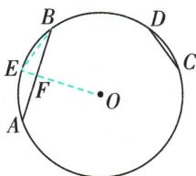

> [!success]- 必刷题
>
> > [!success] **【答案】** D
>
> > [!note]- **【解析】**
> > 如图, 取 $\widehat{AB}$ 中点 E, 连接 OE 交 AB 于 F, 连接 BE. $\because E$ 为 $\widehat{AB}$ 的中点, AB = 6,
> >
> > $\therefore \widehat{AB} = 2\widehat{EB}, BF = \frac{1}{2} AB = 3, OE \perp AB, \therefore BE > BF,$ 即 $BE > 3.$ $\because \widehat{AB} = 2\widehat{CD},$ $\therefore \widehat{CD} = \widehat{EB}, \therefore CD = BE > 3,$ $\therefore CD$ 的长可能是4，故选D
> >
> > 
