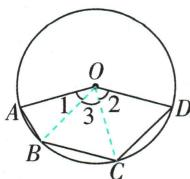

> [!success]- 必刷题
>
> > [!success] **【答案】** D
>
> > [!note]- **【解析】**
> > 如图, 连接 OB, OC. $\because OA = OB = OC = OD$ , $\therefore \triangle OAB, \triangle OBC, \triangle OCD$ 都是等腰三角形. $\because \angle A = 75^{\circ}$ , $\angle D = 60^{\circ}$ , $\therefore \angle 1 = 180^{\circ} -$
> >
> > 
> >
> > $2\angle A=180^{\circ}-2\times75^{\circ}=30^{\circ},\angle2=180^{\circ}-2\angle D=$ $180^{\circ}-2\times60^{\circ}=60^{\circ}.\because\angle AOD=150^{\circ},\therefore\angle3=$ $\angle AOD - \angle 1 - \angle 2 = 150^{\circ} - 30^{\circ} - 60^{\circ} = 60^{\circ}$ ，则劣弧 $\widehat{BC}$ 所对圆心角的度数为 $60^{\circ}$ .
> >
> > 故选 **D**.
