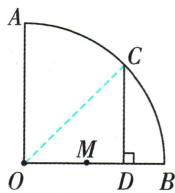
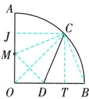

> [!success]- 必刷题
>
> > [!success] **【答案】** A
>
> > [!note]- **【解析】**
> > 当点 M 落在 OB 上时, $CD \perp OB$ , ▶ 关键点拨
> >
> > 如图（1），连接 OC. 由题意得， $\angle AOB = 90^{\circ}, \widehat{AC} = \widehat{CB}$ ，
> > ∴ $\angle AOC = \angle COB = 45^{\circ}$ $\because \angle CDO = 90^{\circ}, \therefore \angle DCO = \angle COD = 45^{\circ}$ ，易得 CD = OD = $2\sqrt{2}$ ; 当点 M 落在 OA 上时，
> >
> > 
> > 图(1)
> >
> > 找出两处特殊位置: ① 点 M 落在 OB 上;
> > - **②**：点 M 落在 OA 上.
> >
> > 连接 CM, CB, CO, DM, 过点 C 作 $CT \perp OB$ 于点 T, $CJ \perp OA$ 于点 J, 如图 (2). ∵ $\angle CJO = \angle JOT = \angle OTC = 90^{\circ}$ , ∴ 四边形 JOTC 是矩形.
> >
> > $\because \angle COB = 45^{\circ}, \therefore OT = TC,$ $\therefore$ 四边形 $JOTC$ 是正方形， $\therefore OJ = OT = CJ = CT = 2\sqrt{2}.$ $\because$ 点 $B$ 关于直线 $CD$ 的对称点为 $M, \therefore CM = CB.$ 又 $\because CJ = CT, \angle CJM = \angle CTB = 90^{\circ}$ ，
> >
> > 
> > 图(2)
> >
> > $\therefore \mathrm{Rt}\triangle CJM\cong \mathrm{Rt}\triangle CTB(\mathrm{HL}),\therefore JM = TB = 4-$ $2\sqrt{2}$ .设 $OD = y$ ，则 $DM = DB = 4 - y.\because OM^2 +$ $OD^{2} = DM^{2},\therefore [2\sqrt{2} -(4 - 2\sqrt{2})]^{2} + y^{2} = (4-$ $y)^{2}$ ，解得 $y = 4\sqrt{2} -4.$ 综上，点 $M$ 落在扇形OAB内（不含边界）时， $OD$ 长的取值范围为 $4\sqrt{2} -4 <   OD <   2\sqrt{2}.$
> >
> > 故选 **A**.
