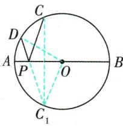
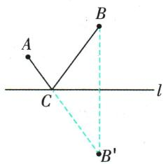

> [!success]- 必刷题
>
> > [!success] **【答案】** $2\sqrt{2}$
>
> > [!note]- **【解析】**
> > 如图,作点 C 关于直径 AB 的对称点 $C_{1}$ , 连接 $DC_{1}$ , 交 AB 于点 P, 此时 $PC+PD$ 的值最小, 连接 $OD, OC_{1}$ . ∵ 点 C 和点 $C_{1}$
> >
> > 
> >
> > 关键点拨
> > 过点 O 作 $OE \perp PA$ 于点
> > E, OF $\perp PB$ 于
> > 点 F，证明
> > Rt $\triangle POE \cong$ Rt $\triangle POF$ 是
> > 解题的关键.
> >
> > 关于直径 AB 对称, 点 C 是上半圆上的三等分点, ∴ AB 垂直平分 $CC_{1}$ , 点 $C_{1}$ 是下半圆上的三等分点, ∴ $PC = PC_{1}$ , $\angle AOC_{1} = 60^{\circ}$ , ∴ $PC + PD = PD + PC_{1} = DC_{1}$ . ∵ 点 D 是 $\widehat{AC}$ 的中点, ∴ 易得 $\angle AOD = 30^{\circ}$ , ∴ $\angle DOC_{1} = \angle DOA + \angle AOC_{1} = 90^{\circ}$ , ∴ 在 Rt $\triangle DOC_{1}$ 中, $DC_{1} = \sqrt{DO^{2} + OC_{1}^{2}} = \sqrt{4 + 4} = 2\sqrt{2}$ , ∴ $PC + PD$ 的最小值为 $2\sqrt{2}$ .
> >
> > ## - 刷有所得 | 求线段长的最值常用模型
> >
> > 点 $A, B$ 在直线 $l$ 的同侧，要在直线 $l$ 上找一点 $C$ ，使点 $C$ 到点 $A, B$ 的距离之和最小，只需作点 $B$ 关于直线 $l$ 的对称点 $B'$ ，连接 $AB', AB'$ 与直线 $l$ 的交点即为所求点 $C$ .
> >
> > 
