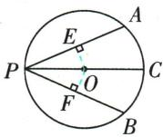
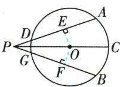
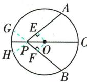

> [!success]- 必刷题
>
> > [!success] **【答案】** (1)
>
> > [!note]- **【解析】**
> > 【证明】如图(1)，过点O作 $OE\perp PA$ 于点E, $OF\perp PB$ 于点F.∵ $\angle APC=\angle BPC,\therefore OE=OF.$ 又∵OP=OP,∴Rt $\triangle POE\cong Rt\triangle POF,$ ∴PE=PF.又∵ $PE=\frac{1}{2}PA,PF=\frac{1}{2}PB,$ ∴PA=PB.
> >
> > 
> >
> > 
> > 图(1)
> > 图(2)
> >
> > 
> > 图(3)
> >
> > 【解】(2)仍有 PA=PB. 理由如下: 如图(2), 过点 O 作 $OE \perp PA$ 于点 E, $OF \perp PB$ 于点 F, 设 AP, BP 与 $\odot O$ 分别交于点 D, G. $\because \angle APC = \angle BPC, \therefore OE = OF, \therefore AD = BG. \because DE = AE = \frac{1}{2}AD, GF = BF = \frac{1}{2}BG, \therefore DE = GF = AE = BF.$ 在 Rt $\triangle OPE$ 与 Rt $\triangle OPF$ 中, $\because \left\{\begin{aligned}OE &= OF, \\ OP &= OP,\end{aligned}\right.$ $\therefore \mathrm{Rt}\triangle OPE \cong \mathrm{Rt}\triangle OPF(\mathrm{HL}), \therefore PE = PF,$ $\therefore PA = PB.$ (3)(1)中结论仍然成立. 理由如下: 如图(3), 过点 O 作 $OE \perp PA$ 于点 E, $OF \perp PB$ 于点 F, 延长 AP 交 $\odot O$ 于点 H, 延长 BP 交 $\odot O$ 于点 G. $\because \angle APC = \angle BPC, \therefore OE = OF.$ 在同圆中弦心距相等,则相对应的弦相等, $\therefore AH=BG.$ 在 Rt△POE 和 Rt△POF 中, $\left\{\begin{aligned}OE&=OF,\\ OP&=OP,\end{aligned}\right.$ $\therefore \mathrm{Rt}\triangle POE\cong\mathrm{Rt}\triangle POF(\mathrm{HL}),\therefore PE=PF.$ 又∵ $EH=\frac{1}{2}AH, FG=\frac{1}{2}BG, \therefore EH=FG, \therefore EH-PE=GF-PF,$ 即 PH=PG,∴ PA=PB.
> >
> > ## 24.1.4 圆周角
