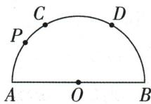
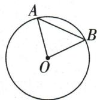

<!-- question-source:start -->
2[2024 北京海淀区期中]如图,AB 是半圆 O 的直径,点 C,D 将 $\widehat{AB}$ 分成相等的三段弧,点 P 在 $\widehat{AC}$ 上.已知点 Q 在 $\widehat{AB}$ 上且 $\angle APQ = 115^{\circ}$ ,则点 Q 所在的弧是
A. $\widehat{AP}$ B. $\widehat{PC}$ C. $\widehat{CD}$ D. $\widehat{DB}$

(第2题图)

(第3题图)
<!-- question-source:end -->

![[Q00106866A1]]
