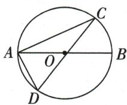
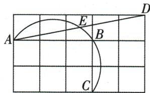

<!-- question-source:start -->
4[2024 山西大同期末]如图,AB为 $\odot O$ 的直径,点C,D在圆上且在直径AB的两侧,若 $\angle BAC=25^{\circ}$ ,则 $\angle D$ 的度数为() A. $40^{\circ}$ B. $45^{\circ}$ C. $65^{\circ}$ D. $75^{\circ}$

(第4题图)

(第5题图)
<!-- question-source:end -->

![[Q00106868A1]]
