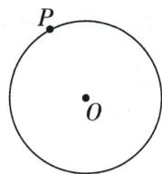
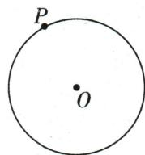

<!-- question-source:start -->
6[2025 江苏南京质检]已知 P 是 $\odot O$ 上一点, 在 $\odot O$ 上作两点 A, B, 使得 $\angle APB$ 分别满足以下条件:

(1)在图(1)中, $\angle APB=90^{\circ}$ ;

(2) 在图(2)中, $\angle APB = 30^{\circ}$ .

(说明:第(1)题只用无刻度的直尺作图,第(2)题只用圆规作图.保留作图痕迹,不写作法)

图(1)

图(2)
<!-- question-source:end -->

![[Q00106870A1]]
