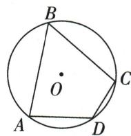
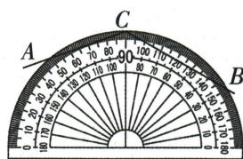

<!-- question-source:start -->
7[2024 浙江宁波期末]如图,在圆内接四边形ABCD中,若 $\angle A,\angle B,\angle C$ 的度数之比为4:3:5,则 $\angle D$ 的度数是( )
A. 80° B. 100° C. 110° D. 120°

(第7题图)
(第8题图)
<!-- question-source:end -->

![[Q00106871A1]]
