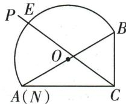

<!-- question-source:start -->
1[2024 河北保定期末, 中]如图, 量角器的直径与直角三角板 ABC 的斜边 AB 重合, 其中量角器 0 刻度线的端点 N 与点 A 重合, 射线 CP 从

数是 （ ）
A. $18^{\circ}$ B. $36^{\circ}$ C. $72^{\circ}$ D. $144^{\circ}$
<!-- question-source:end -->

![[Q00106873A1]]
