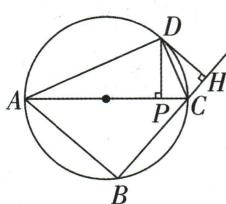
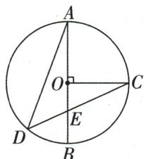

<!-- question-source:start -->
2 构造同弧所对的圆周角 [2025 浙江杭州质检, 中] 如图, 圆内接 $\triangle ABC$ 的外角 $\angle ACH$ 的平分线与圆相交于点 $D, DP \perp AC$ , 垂足为 $P, DH \perp BH$ , 垂足为 $H$ , 有下列结论: ① $\widehat{AD} = \widehat{BD}$ ; ② $AP = BH$ ; ③ $\widehat{AB} = \widehat{BC}$ , 其中一定成立的结论有 ( )

A. 1个 B. 2个 C. 3个 D. 0个

(第2题图)

(第3题图)
<!-- question-source:end -->

![[Q00106874A1]]
