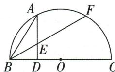

<!-- question-source:start -->
6[中]如图,BC为半圆O的直径, $AD\perp BC$ ,垂足为D, $\widehat{BA}=\widehat{AF}$ ,BF与AD交于E.
(1) 求证: AE = BE;
(2) 若 A, F 把半圆三等分, BC = 12, 求 AE 的长.

<!-- question-source:end -->

![[Q00106877A1]]
