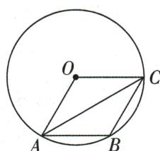
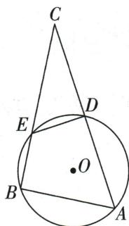

<!-- question-source:start -->
5 构造直角三角形 [2025 江苏南京质检, 中] 如图, $\odot O$ 的半径为 4, $\triangle ABC$ 的顶点 $A, B$ 在 $\odot O$ 上, $\angle B = 90^{\circ}$ , $\angle A = 60^{\circ}$ , $AC, BC$ 分别与 $\odot O$ 交于 $D, E$ 两点, 且 $BE = DE$ , 则 $\triangle ABC$ 的面积为 \_\_\_\_.

<!-- question-source:end -->

![[Q00107266A1]]
