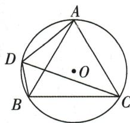

<!-- question-source:start -->
7 [2024 安徽芜湖期末, 中] 如图, 四边形 $ADBC$ 内接于 $\odot O$ , $\triangle ABC$ 是等边三角形, $\odot O$ 的半径为 2 , 点 $D$ 在劣弧 $\widehat{AB}$ 上运动 (不与点 $A, B$ 重合). (1) 当点 $D$ 在劣弧 $\widehat{AB}$ 中点时, 四边形 $ADBC$ 的面积是 \_\_\_\_ ; (2) 求四边形 $ADBC$ 的面积 $S$ 与线段 $DC$ 的长 $x$ 之间的函数关系式.

电子错题本鸭
<!-- question-source:end -->

![[Q00107267A1]]
