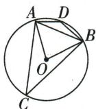

> [!success]- 必刷题
>
> > [!success] **【答案】** $40^{\circ}$ 或 $140^{\circ}$
>
> > [!note]- **【解析】**
> > 如图， $\angle ACB$ 和 $\angle ADB$ 为▶易错警示
> >
> > 
> >
> > 弦 AB 所对的圆周角. ∵ $\angle AOB$ 和 $\angle ACB$ 都对应 $\widehat{AB}, \therefore \angle ACB = \frac{1}{2} \angle AOB = \frac{1}{2} \times 80^{\circ} = 40^{\circ}$ .
> >
> > ∵ $\angle ACB + \angle ADB = 180^{\circ}, \therefore \angle ADB = 180^{\circ} - 40^{\circ} = 140^{\circ}$ , 即弦 AB 所对的圆周角的度数为 $40^{\circ}$ 或 $140^{\circ}$ . 故答案为 $40^{\circ}$ 或 $140^{\circ}$ .
