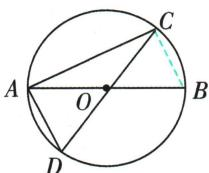
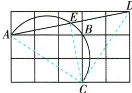

> [!success]- 必刷题
>
> > [!success] **【答案】** C
>
> > [!note]- **【解析】**
> > 如图, 连接 BC. ∵ AB 为 ⊙O 的直径, ∴ $\angle ACB = 90^{\circ}$ , ∴ $\angle CBA = 90^{\circ} - \angle BAC = 90^{\circ} - 25^{\circ} = 65^{\circ}$ , ∴ $\angle D = \angle CBA = 65^{\circ}$ . 故选 C.
> >
> > 圆是一种极为重要的几何图形,经常出现多结论情况:(1)由于点在圆周上的位置不确定而分类讨论;(2)由于弦所对弧为优弧和劣弧两种情况而分类讨论;(3)由于弦的位置不确定而分类讨论.
> >
> > 
> >
> > 
> > (第4题图)
> > (第5题图)
