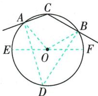

> [!success]- 必刷题
>
> > [!success] **【答案】** $130^{\circ}
>
> > [!note]- **【解析】**
> > 根据题意构造 $\odot O$ ，在下半圆上
> >
> > 取点 D，连接 OA, OB, DA, DB，设 $\odot O$ 的直径为 EF，如图。由题意可知， $\angle AOE = 50^{\circ}$ ， $\angle EOB = 150^{\circ}$ ，∴ $\angle AOB = \angle EOB -$
> >
> > 
> >
> > $\angle AOE = 150^{\circ} - 50^{\circ} = 100^{\circ}, \therefore \angle ADB = \frac{1}{2}\angle AOB = 50^{\circ}.$ 四边形 $ACBD$ 为 $\odot O$ 的内接四边形， $\therefore \angle ACB + \angle ADB = 180^{\circ}, \therefore \angle ACB = 130^{\circ}.$ 故答案为 $130^{\circ}.$
