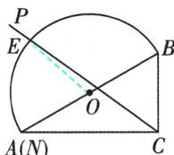
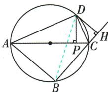

> [!success]- 必刷题
>
> > [!success] **【答案】** C
>
> > [!note]- **【解析】**
> > 如图, 连接 OE. ∵ 射线 CP 从 CA 处出发, 以每秒 $3^{\circ}$ 的速度顺时针旋转, ∴ 第 12 秒时, $\angle ACE = 3^{\circ} \times 12 = 36^{\circ}$ . ∵ $\angle ACB = 90^{\circ}$ , ∴ 点 C 在以 AB 为直径的圆上, 即点 C 在 $\odot O$ 上, ∴ $\angle EOA = 2\angle ECA = 2 \times 36^{\circ} = 72^{\circ}$ , 故选 C.
> >
> > 
> >
> > 
> > (第1题图)
> > (第2题图)
