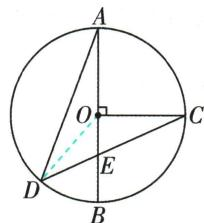

> [!success]- 必刷题
>
> > [!success] **【答案】** 20
>
> > [!note]- **【解析】**
> > 连接 $OD$ , 如图. $\because OC \perp AB, \therefore \angle COE = 90^{\circ}.$ $\because \angle AEC = 65^{\circ}, \therefore \angle OCE = 180^{\circ} - 90^{\circ} - 65^{\circ} = 25^{\circ}.$ $\because OC = OD, \therefore \angle ODC = \angle OCE = 25^{\circ}, \therefore \angle DOC =$
> >
> > 
> >
> > $180^{\circ} - 25^{\circ} - 25^{\circ} = 130^{\circ}, \therefore \angle BOD = \angle DOC - \angle COE = 40^{\circ}, \therefore \angle BAD = \frac{1}{2} \angle BOD = 20^{\circ}$ . 故答案为 20.
