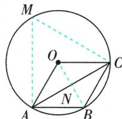

> [!success]- 必刷题
>
> > [!success] **【答案】** 2
>
> > [!note]- **【解析】**
> > 如图, 在 $\odot O$ 上找一点 M, 连接 AM, CM, OB, OB 交 AC 于点 N, 则 $\angle AOC =$
> >
> > $2\angle AMC.\because$ 四边形 $OABC$ 是平行四边形， $\therefore \angle ABC =$ $\angle AOC = 2\angle AMC.\because$ 四边形 $MABC$ 是 $\odot O$ 的内接四边形， $\therefore \angle AMC + \angle ABC =$
> >
> > 
> >
> > $180^{\circ}, \therefore \angle AMC + 2\angle AMC = 180^{\circ}, \therefore \angle AMC = 60^{\circ}, \therefore \angle AOC = 120^{\circ}. \because$ 四边形 $OABC$ 是平行四边形, $OA = OC$ , $\therefore$ 四边形 $OABC$ 是菱形, $\therefore AN = CN = \frac{1}{2} AC = \frac{1}{2} \times 2\sqrt{3} = \sqrt{3}$ , $\angle AOB = \angle COB = 60^{\circ}$ , $\angle ONA = 90^{\circ}$ , $\therefore \angle OAN = 30^{\circ}$ , $\therefore OA = 2ON, \therefore (2ON)^{2} = ON^{2} + (\sqrt{3})^{2}, \therefore ON = 1, \therefore OA = 2ON = 2$ , 故答案为 2.
