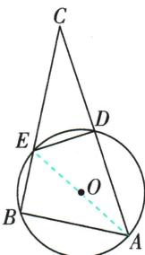

> [!success]- 必刷题
>
> > [!success] **【答案】** $24\sqrt{3}$
>
> > [!note]- **【解析】**
> > 如图, 连接 AE. ∵ $\angle CBA = 90^{\circ}$ ,
> > ∴ AE 为 $\odot O$ 的直径，∴ $\angle ADE = 90^{\circ}, AE = 8$ .
> >
> > 思路分析
> > (2) 将 $\triangle ADC$ 绕点 C 逆时针旋转 $60^{\circ}$ ，得到 $\triangle BHC$ ，证明 $\triangle DCH$ 是等边三角形，再根据等边三角形的性质解答即可.
> >
> > $\because BE = DE, \therefore \widehat{BE} = \widehat{DE},$ $\therefore \angle BAE = \angle DAE.\because \angle BAC = 60^{\circ},\therefore \angle BAE = \angle DAE = 30^{\circ},$ $\therefore BE = DE = \frac{1}{2} AE = 4,\therefore AB = \sqrt{AE^{2} - BE^{2}} = \sqrt{8^{2} - 4^{2}} = 4\sqrt{3}.$ $\because \angle C = 180^{\circ} - \angle ABC -$
> >
> > 
> >
> > $\angle BAC = 180^{\circ} - 90^{\circ} - 60^{\circ} = 30^{\circ}, \angle CDE = 180^{\circ} - 90^{\circ} = 90^{\circ}, \therefore EC = 2ED = 8, \therefore BC = BE + CE = 12,$ $\therefore S_{\triangle ABC} = \frac{1}{2} AB \cdot BC = \frac{1}{2} \times 4\sqrt{3} \times 12 = 24\sqrt{3}$ . 故答案为 $24\sqrt{3}$ .
