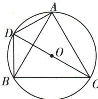
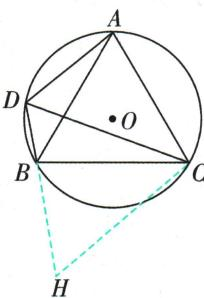

> [!success]- 必刷题
>
> > [!success] **【答案】** $4\sqrt{3}$
>
> > [!note]- **【解析】**
> > 【解】(1)如图(1).∵△ABC是等边三角形，
> > ∴∠ABC=∠BAC=∠ACB=60°,∴∠ADC=
> >
> > $$
> > \angle A B C = 6 0 ^ {\circ}, \angle B D C =
> > $$
> >
> > $$
> > \angle B A C = 6 0 ^ {\circ}. \because
> > $$
> >
> > $$
> > \widehat {A B}
> > $$
> >
> > $$
> > \therefore \angle A C D =
> > $$
> >
> > 
> >
> > $$
> > \angle B C D = \frac {1}{2} \angle A C B = 3 0 ^ {\circ}
> > $$
> >
> > $$
> > \therefore \angle D A C = \angle D B C = 9 0 ^ {\circ}
> > $$
> >
> > 图(1)
> >
> > $\therefore CD$ 是 $\odot O$ 的直径， $\therefore CD = 4$ ，易得 $AD = BD = 2,BC = AC = 2\sqrt{3},\therefore S_{\text{四边形} ADBC} = S_{\triangle ADC} + S_{\triangle BDC} =$ $\frac{1}{2}\times 2\times 2\sqrt{3} +\frac{1}{2}\times 2\times 2\sqrt{3} = 4\sqrt{3}$ 故答案为 $4\sqrt{3}$
> >
> > (2)如图(2)，将 $\triangle ADC$ 绕点 $C$ 逆时针旋转 $60^{\circ}$ ，得到 $\triangle BHC$ ，则 $CD = CH,$ $\angle DAC = \angle HBC.\because$ 四边形ACBD是圆内接四边形， $\therefore \angle DAC + \angle DBC = 180^{\circ},$ $\therefore \angle DBC + \angle HBC = 180^{\circ},$ $\therefore$ 点 $D,B,H$ 共线. $\because DC =$
> >
> > 
> > 图(2)
> >
> > $CH, \angle CDH = 60^{\circ}, \therefore \triangle DCH$ 是等边三角形， $\therefore$ 四边形 $ADBC$ 的面积 $S = S_{\triangle ADC} + S_{\triangle BDC} = S_{\triangle CDH} = \frac{\sqrt{3}}{4} CD^{2}, \therefore S = \frac{\sqrt{3}}{4} x^{2}$ .
