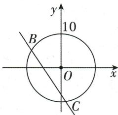
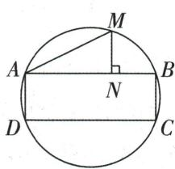

<!-- question-source:start -->
1[2024 湖北鄂州期末, 中]如图, 在平面直角坐标系中, $\odot O$ 经过点 (0, 10), 直线 $y = kx + 2k - 4$ 与 $\odot O$ 交于 $B, C$ 两点, 则弦 $BC$ 的最小值是
( )
A. $6\sqrt{2}$ B. $10\sqrt{3}$ C. $8\sqrt{5}$ D. 以上都不对

(第1题图)

(第2题图)
<!-- question-source:end -->

![[Q00106879A1]]
