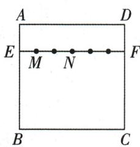
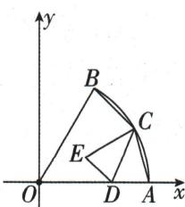

<!-- question-source:start -->
3[中]如图,在正方形纸片ABCD中,EF//AD,M,N是线段EF的六等分点,若把该正方形纸片卷成一个圆柱,使点A与点D重合,此时,底面圆的直径为10cm,则圆柱上M,N两点间的距离是\_\_\_\_cm.

(第3题图)

(第4题图)
<!-- question-source:end -->

![[Q00106881A1]]
