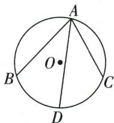
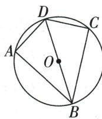

<!-- question-source:start -->
5[中]如图(1)，在 $\odot O$ 中，弦 $AD$ 平分圆周角 $\angle BAC$ ，我们将圆中以 $A$ 为公共点的三条弦 $BA$ ， $CA,DA$ 构成的图形称为圆中“爪形 $A$ ”。如图(2)，四边形 $ABCD$ 内接于 $\odot O,AB=BC$ 。
(1)求证:图(2)中存在圆中“爪形 $D$ ”；
(2)若 $\angle ADC=120^{\circ}$ ，求证: $AD+CD=BD$ 。

图(1)

图(2)
<!-- question-source:end -->

![[Q00106883A1]]
