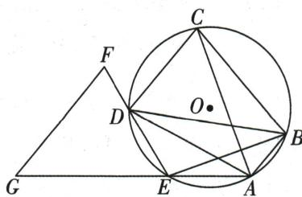

<!-- question-source:start -->
6[2025 江苏徐州期中, 中]如图, 在 $\odot O$ 中, 弦 $AB \parallel CD$ , 点 $E$ 在 $\widehat{AD}$ 上, 延长 $ED$ 至点 $F$ , 使 $EF = EB$ , 延长 $AE$ 至点 $G$ , 连接 $GF$ , 使 $\angle F = \angle EAC, GF = AD$ .

(1) 连接 $CB$ , 求证: $GF = CB$ ;

(2) 若 $\angle F = 70^{\circ}, CA$ 为 $\odot O$ 直径, 求 $\angle ABE$ 的度数;

(3) 连接 BD, 求证: $\angle G = \angle BDE$ .

<!-- question-source:end -->

![[Q00106884A1]]
