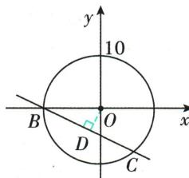

> [!success]- 必刷题
>
> > [!success] **【答案】** C
>
> > [!note]- **【解析】**
> > 对于直线 $y = kx + 2k - 4$ ，当 x = -2 时，y = -4，故直线 $y = kx + 2k - 4$ 恒经过点 $(-2,$
> >
> > -4)，记为点 $D$ ，连接 $OD.$ 由于过圆内定点 $D$ 的所有弦中，与 $OD$ 垂直的弦最短，即当 $BD\bot OD$ 时，BC最短，如图所示. $\because D(-2, - 4),\therefore OD =$
> >
> > 
> >
> > $\sqrt{(-2)^{2}+(-4)^{2}}=2\sqrt{5}.\because\odot O$ 经过点(0,10), $\therefore OB=10,\therefore BD=\sqrt{OB^{2}-OD^{2}}=\sqrt{10^{2}-(2\sqrt{5})^{2}}=4\sqrt{5}.\because DB\perp OD,\therefore BC=2BD=8\sqrt{5},\therefore$ 弦 BC 的最小值是 $8\sqrt{5}$ .
> >
> > 故选 **C**.
