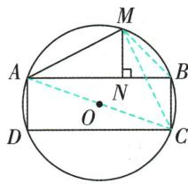
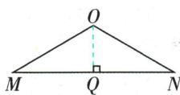

> [!success]- 必刷题
>
> > [!success] **【答案】** A
>
> > [!note]- **【解析】**
> > 如图, 连接 AC, CM, BM, 设 AC 的中点为 O. ∵ 四边形 ABCD 为矩形, ∴ $\angle ABC = 90^{\circ}$ , ∴ AC 为 $\odot O$ 的直径, O 为圆心,
> >
> > 
> >
> > 关键点拨
> > 连接 AC，设 AC 的中点为 O，由 $\angle ABC = 90^{\circ}$ 得 AC 是 $\odot O$ 的直径是解题的关键.
> >
> > $\therefore \angle AMC = 90^{\circ}.\because \odot O$ 的半径为 $5,\therefore AC = 10.$ $\because$ 点 $M$ 为 $\widehat{ABC}$ 的中点， $\therefore \widehat{AM} = \widehat{CM},\therefore AM =$ $CM,\angle ACM = \angle CAM = 45^{\circ},\therefore AM^{2} + CM^{2} =$ $2AM^{2} = AC^{2} = 10^{2},\therefore AM^{2} = 50.$ 设 $AB = x,BC =$ $y$ ，其中 $x > y > 0$ ，则 $\left\{ \begin{array}{l}x^{2} + y^{2} = 10^{2},\\ xy = 30, \end{array} \right.$ ： $\left\{ \begin{array}{l}x = 3\sqrt{10},\\ y = \sqrt{10}, \end{array} \right.$ 即 $AB = 3\sqrt{10},BC = \sqrt{10}.$ ∵ $MN\perp AB$ $\angle MBA = \angle MCA = 45^{\circ},\therefore \angle BMN = 45^{\circ},$ $\therefore MN = BN,\therefore AN = AB - BN = 3\sqrt{10} -MN.$ 在 Rt△AMN 中， $AN^{2} + MN^{2} = AM^{2},\therefore (3\sqrt{10}-$ $MN)^{2} + MN^{2} = 50$ ，解得 $MN = \sqrt{10}$ 或 $MN =$ $2\sqrt{10}$ （舍去），故选A.
> >
> > $$
> > \sqrt {3}
> > $$
> >
> > 
