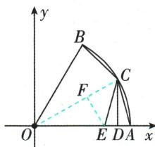

> [!success]- 必刷题
>
> > [!success] **【答案】** $4\sqrt{3}-4$
>
> > [!note]- **【解析】**
> > 如图, 连接 OC, 作 $EF \perp OC$
> >
> > 思路分析
> > 连接 OC，作 $EF \perp OC$ 于 F，根据圆心角、弧、弦之间的关系得到 $\angle AOC = 30^{\circ}$ ，再根据等腰三角形的性质、三角形内角和定理得到 $\angle ECF = 45^{\circ}$ ，最后根据含 $30^{\circ}$ 角的直角三角形的性质列式计算即可.
> >
> > 于 $F$ . $\because$ 点 $A$ 关于直线 $CD$ 的对称点为点 $E$ , 点 $E$ 落在半径 $OA$ 上, $\therefore CE = CA$ . $\because \widehat{AC} = \widehat{BC}, \therefore \angle AOC = \frac{1}{2} \angle AOB = 30^{\circ}$ . $\because OA =$
> >
> > 
> >
> > $OC, \therefore \angle OAC = \angle OCA = 75^{\circ}$ . $\because CE = CA$ , $\therefore \angle CAE = \angle CEA = 75^{\circ}, \therefore \angle ACE = 30^{\circ}, \therefore \angle ECF = 45^{\circ}$ . 设 $EF = x$ , 则 $FC = x$ . 在 Rt $\triangle EOF$ 中, $\because \angle AOC = 30^{\circ}, \angle EFO = 90^{\circ}, \therefore$ 由勾股定理易得 $OF=\sqrt{3}x$ . 由题意得, $OF+FC=OC$ , 即 $\sqrt{3}x+x=4$ , 解得 $x=2\sqrt{3}-2$ . $\because \angle EOF=30^{\circ}$ , $\therefore OE=2EF=4\sqrt{3}-4$ . 故答案为 $4\sqrt{3}-4$ .
