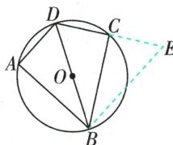

> [!success]- 必刷题
>
> > [!success] **【答案】** AD
>
> > [!note]- **【解析】**
> > 【证明】(1)∵ AB=BC, ∴ $\widehat{AB}=\widehat{BC}$ , ∴ $\angle ADB=\angle CDB$ , ∴ DB 平分圆周角 $\angle ADC$ , ∴ 题图(2)中存在圆中“爪形 D”.
> >
> > $$
> > C E = A D
> > $$
> >
> > $$
> > \because \angle A + \angle D C B = 1 8 0 ^ {\circ}
> > $$
> >
> > $$
> > \angle E C B + \angle D C B = 1 8 0 ^ {\circ}
> > $$
> >
> > 
> >
> > $$
> > \therefore \angle A = \angle E C B. \because C E =
> > $$
> >
> > $AD, AB = BC, \therefore \triangle BAD \cong \triangle BCE$ (SAS), $\therefore \angle E = \angle ADB.\because \angle ADC = 120^{\circ}, \therefore \angle E = \angle ADB = \angle CDB = 60^{\circ}, \therefore \triangle BDE$ 是等边三角形， $\therefore DE = BD$ ，即 $AD + CD = BD$ .
