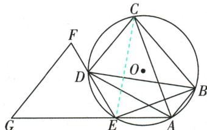

> [!success]- 必刷题
>
> > [!success] **【答案】** (1)
>
> > [!note]- **【解析】**
> > 【证明】∵ AB ∥ CD, ∴ ∠ACD = ∠CAB,
> > ∴ $\widehat{AD} = \widehat{BC}$ , ∴ AD = BC. ∵ GF = AD, ∴ GF = CB.
> > (2)【解】∵ CA 为 ⊙O 直径, ∴ ∠CBA = 90°.
> > ∵ ∠EAC = ∠F = 70°, ∴ ∠CBE = ∠EAC = 70°,
> > ∴ ∠ABE = ∠CBA - ∠CBE = 20°.
> > (3)【证明】连接 EC, 如图. ∵ ∠EAC = ∠EBC,
> > ∠F = ∠EAC, ∴ ∠F = ∠EBC. 又∵ GF = CB,
> > EF = EB, ∴ △EBC ≅ △EFG(SAS), ∴ ∠G =
> > ∠BCE. ∵ ∠BCE = ∠BDE, ∴ ∠G = ∠BDE.
> >
> > 
