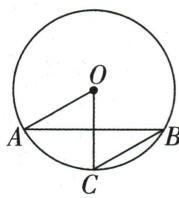

<!-- question-source:start -->
1[2025 广东广州质检]如图, $\odot O$ 中,弦AB的长

为 $4\sqrt{3}$ , 点 $C$ 在 $\odot O$ 上, $OC \perp AB$ , $\angle ABC = 30^{\circ}$ . $\odot O$ 所在的平面内有一点 $P$ , 若 $OP = 5$ , 则点 $P$ 与 $\odot O$ 的位置关系是 ( )

A. 点 $P$ 在 $\odot O$ 上

B. 点 $P$ 在 $\odot O$ 内

C. 点 $P$ 在 $\odot O$ 外

D. 无法确定

<!-- question-source:end -->

![[Q00106885A1]]
