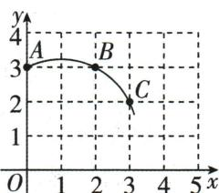

<!-- question-source:start -->
3[2025 天津南开区期中]如图,在平面直角坐标系中,点 O 为坐标原点,A(0,3),B(2,3),C(3,2),一条圆弧经过 A,B,C 三点,则下列说法中正确的是

( )

A.这条圆弧所在圆的半径为 $\frac{5}{2}$ B.这条圆弧所在圆的圆心为(1,1) C.原点 $O(0,0)$ 在这条圆弧所在圆上 D.点 $N(3,0)$ 在这条圆弧所在圆外
<!-- question-source:end -->

![[Q00106887A1]]
