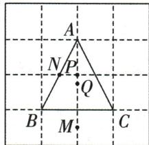
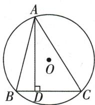

<!-- question-source:start -->
5[2024 河北沧州期中]如图,在 $4 \times 4$ 的正方形网格中,A,B,C 是三个格点,其中每个小正方形的边长为 1, $\triangle ABC$ 的外心可能是()

A. $M$ 点 B. $N$ 点C. $P$ 点 D. $Q$ 点

(第5题图)
(第7题图)
<!-- question-source:end -->

![[Q00106889A1]]
