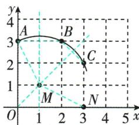

> [!success]- 必刷题
>
> > [!success] **【答案】** B
>
> > [!note]- **【解析】**
> > 如图, 连接 AB, BC, 作 AB, BC 的垂直平分线交于点 M, 连接 AM, 则点 M 是圆弧
> >
> > 所在圆的圆心, 点 M 的坐标为 $(1,1)$ , ∴ MA = $\sqrt{1^{2}+2^{2}}=\sqrt{5}$ , 即这条圆弧所在圆的半径为 $\sqrt{5}$ , 因此选项 A 不符合题
> >
> > 
> >
> > 意,选项 B 符合题意. 连接 OM. $\because OM = \sqrt{1^{2} + 1^{2}} = \sqrt{2} < \sqrt{5}, \therefore$ 点 $O(0,0)$ 在这条圆弧所在圆内, 因此选项 C 不符合题意. 连接 MN. $\because N(3,0), \therefore MN = \sqrt{(3-1)^{2} + (0-1)^{2}} = \sqrt{5},$ ∴ 点 $N(3,0)$ 在这条圆弧所在圆上, 因此选项 D 不符合题意.
> >
> > 故选 **B**.
